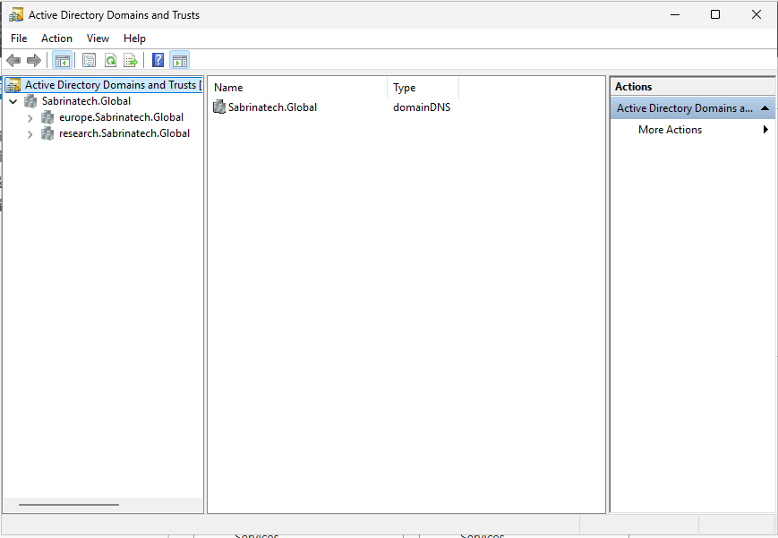
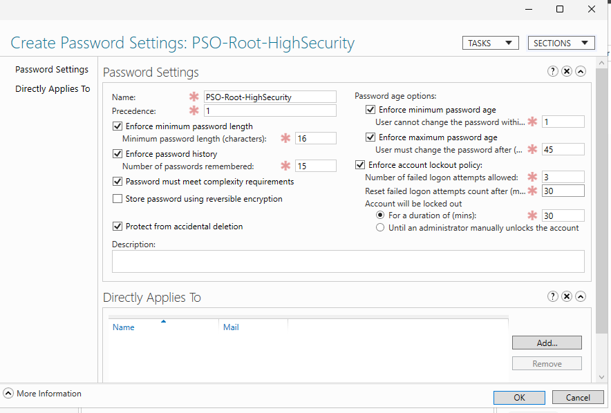
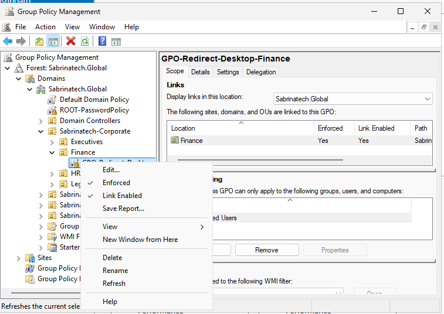
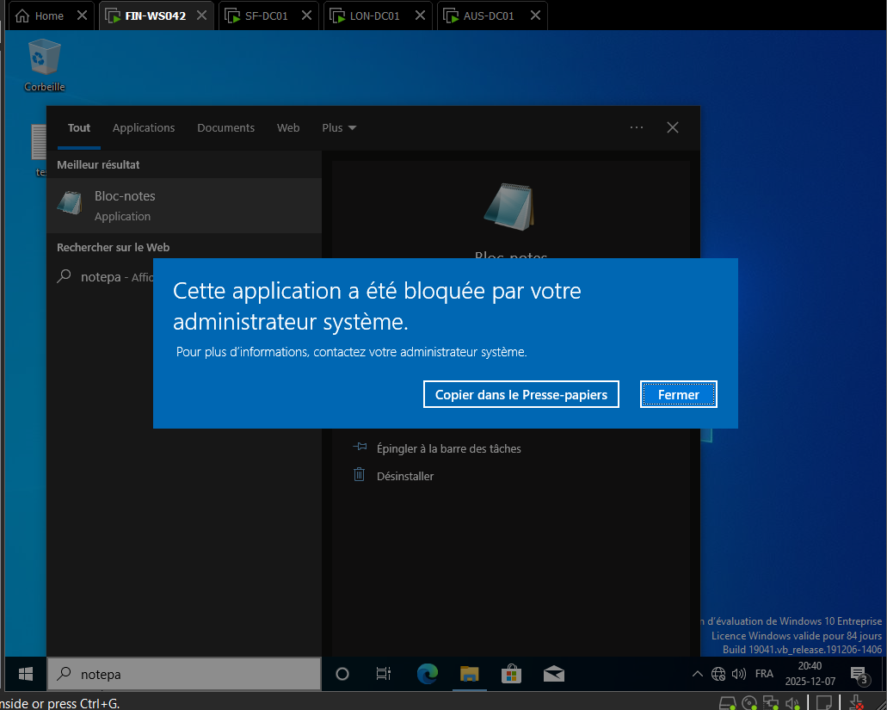
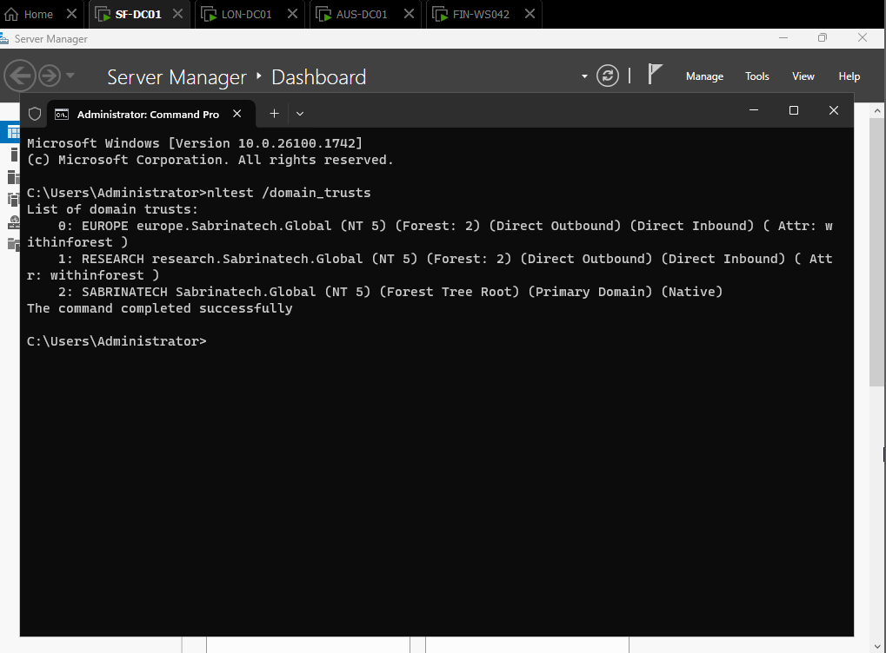
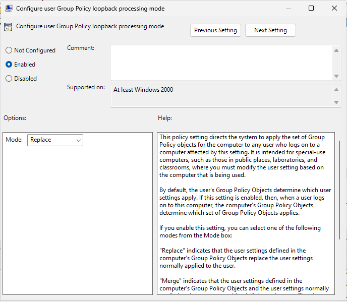
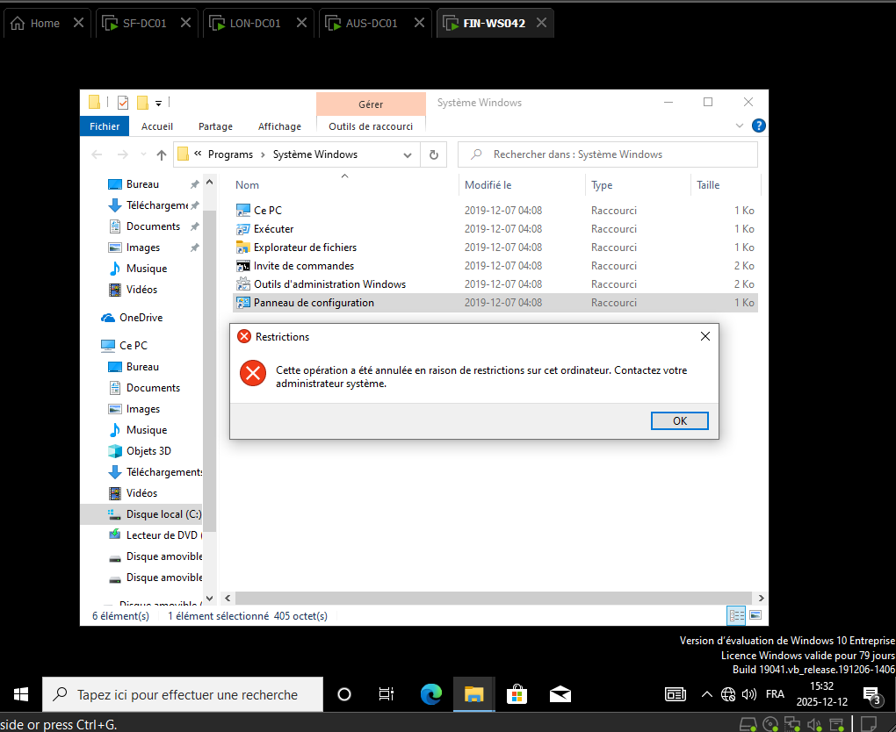

# Conception et sécurisation d'une infrastructure Active Directory multidomaine

## Présentation du projet

Ce projet académique porte sur la conception, l'implémentation et la sécurisation d'une infrastructure Active Directory sous Windows Server, à partir de scénarios inspirés des besoins d'une entreprise.

L'objectif est de centraliser l'administration des identités, de sécuriser les accès aux ressources et de déployer des stratégies de groupe adaptées aux différents départements et environnements de travail.

## Architecture de l'infrastructure

L'environnement repose sur une forêt Active Directory multidomaine comprenant :

- **Domaine racine :** `sabrinatec.global`
- **Domaine enfant Europe :** `europe.sabrinatec.global`
- **Domaine enfant Recherche :** `research.sabrinatec.global`

L'infrastructure permet de gérer les utilisateurs, les ordinateurs, les ressources et les politiques de sécurité dans plusieurs domaines.

## Réalisations techniques

### 1. Déploiement et administration Active Directory

- Conception d'une architecture AD DS multidomaine.
- Organisation des utilisateurs et ordinateurs dans des unités d'organisation (OU).
- Administration centralisée des comptes et des ressources.
- Configuration des relations d'approbation entre domaines.

### 2. Sécurisation des comptes et des accès

- Mise en œuvre de politiques de mots de passe granulaires (FGPP).
- Configuration des paramètres de verrouillage des comptes.
- Application de politiques de sécurité adaptées aux groupes d'utilisateurs.

### 3. Gestion des stratégies de groupe (GPO)

- Création et déploiement de GPO.
- Configuration de la redirection des dossiers utilisateurs.
- Gestion des paramètres de sécurité des postes.
- Importation et adaptation de GPO entre domaines parent et enfant.

### 4. Contrôle des applications avec AppLocker

- Configuration de règles de restriction d'exécution.
- Mise en place d'un scénario de blocage de Notepad.
- Vérification du comportement des règles sur un poste client.

### 5. Sécurisation des postes partagés — Hot Desk

- Création d'une unité d'organisation dédiée aux postes partagés.
- Configuration du traitement en boucle des GPO (*Loopback Processing*) en mode Replace.
- Application d'un fond d'écran d'entreprise.
- Restriction de l'accès au Panneau de configuration.
- Mise en œuvre de restrictions du bureau et des périphériques USB.

## Tests et validation

Les configurations ont été contrôlées au moyen de tests fonctionnels et d'outils d'administration Windows, notamment :

```powershell
gpupdate /force
gpresult /r
nltest /domain_trusts
```

Les scénarios de validation portent sur l'application des GPO, les restrictions AppLocker, les relations d'approbation et les politiques des postes partagés.

## Compétences démontrées

- Administration Windows Server et Active Directory
- Gestion des identités et des accès
- Sécurisation des comptes utilisateurs
- Administration des stratégies de groupe
- Contrôle des applications et des postes de travail
- Dépannage et validation des politiques de sécurité
- Documentation technique

## Documentation du projet


## Documentation et preuves techniques

Les captures suivantes sont issues du laboratoire Active Directory réalisé sous Windows Server. Elles illustrent les configurations mises en place et les tests effectués.

### 1. Architecture Active Directory multidomaine



Présentation de l'infrastructure Active Directory, comprenant un domaine racine et deux domaines enfants. Cette architecture permet une administration centralisée des identités, des ressources et des politiques de sécurité.

### 2. Sécurisation des comptes — FGPP



Configuration d'une politique de mots de passe granulaires (Fine-Grained Password Policy) destinée à renforcer la sécurité des comptes d'un groupe d'utilisateurs.

### 3. Redirection des dossiers utilisateurs



Configuration d'une stratégie de groupe permettant la redirection des dossiers utilisateurs vers un emplacement centralisé.

### 4. Contrôle des applications avec AppLocker



Test d'une règle AppLocker visant à empêcher l'exécution d'une application non autorisée sur un poste client.

### 5. Vérification des relations d'approbation



Utilisation des outils de diagnostic Active Directory pour examiner les relations d'approbation entre les domaines de l'infrastructure.

### 6. Configuration du Loopback Processing



Configuration du traitement en boucle des stratégies de groupe en mode Replace, dans le cadre d'un scénario de postes de travail partagés (Hot Desk).

### 7. Validation des restrictions du poste client



Test de l'application d'une stratégie de groupe restreignant l'accès au Panneau de configuration sur un poste client.

---

**Contexte :** Projet académique réalisé au Collège LaSalle, Montréal.

**Technologies :** Windows Server, AD DS, GPMC, FGPP, AppLocker, PowerShell et stratégies de groupe.


---

**Contexte :** Projet académique réalisé au Collège LaSalle, Montréal.

**Environnement :** Windows Server, Active Directory Domain Services, Group Policy Management et PowerShell.
